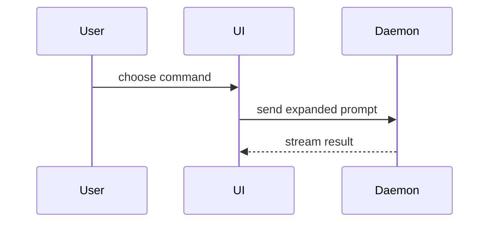

写 PR 正文时使用下面这个模板：

```markdown
## Summary

<diagram, diff-sketch, or tree>

## Evidence

- **Before:** <screenshot/output/failing test run>
  **After:** <screenshot/output/passing test run>

## Merge Danger

**Door:** <one-way or two-way>

<optional: description>

**Blast Radius:** <one-word description>

<optional: potential ramifications of merge>
```

## 各小节

跳过所有开场白，文字保持简短。使用 `GLOSSARY.md` 里用户的领域用语。

### Summary（总结）

挑能讲清关键要点的最小视图。

- 用伪代码展示逻辑或算法：

```text
on(save)
  if content is unchanged
    return cached result
  write new content
  return fresh result
```

- 用调用树展示运行时控制流：

```text
submitForm
  createSession
    persistPrompt
    launchAgent
  navigateToSession
```

- 用组件树展示 UI（用户界面）结构，并包含其中要紧的状态和模块边界：

```text
<SessionPage> (apps/example/src/routes/session.tsx)
  useSessionEvents()
  <SessionToolbar>
    <RunSkillButton> (packages/ui)
```

- 用浅层文件树展示文件职责或一次大范围重构：

```text
src/
├── commands/       # parses user actions
├── sessions/       # owns session state
└── transport/      # sends API requests
```

- 用 Mermaid 展示组件交互、控制流或数据流：



- 当要点在于改了什么，而它周围的形态已经存在时，使用 `diff`。diff 的形状要贴合主题。

组件变更：

```diff
 <SessionPage>
   useSessionEvents()
   <SessionToolbar>
+    <RunSkillButton />
   <SessionTimeline>
+    <SkillResultCard />
```

文件布局变更：

```diff
 src/
 ├── commands/
+│   └── show-me.ts       # expands the slash command
 ├── sessions/
-└── transport.ts
+└── transport/
+    ├── client.ts
+    └── stream.ts
```

调用树或调用栈变更：

```diff
 submitForm
   createSession
     persistPrompt
+    expandSkillMention
     launchAgent
-  navigateToSession
+  navigateToSession
+    subscribeToEvents
```

状态或控制流变更：

```diff
 on(save)
-  write content
+  if content is unchanged
+    return cached result
+  write new content
+  invalidate cache
```

- 当一段代码大部分是新增的、省略上下文会掩盖归属或顺序、或者用户需要一份可直接复制的目标形态时，展示整块内容：

```ts
function expandSkill(command: string): string {
  const skillName = command.slice(1);
  return `use the ${skillName} skill`;
}
```

#### 排布建议

把每个可视化图形放在它所支撑的简短文字旁边。只保留回答用户当前问题所需的调用、文件、props（属性）、状态和边界，或者敲定当前讨论点所涉及的几个选项。

这些形式可以用一个，也可以用几个，一般不会全都用上。自己拿主意，别把用户淹没。

### Evidence（证据）

用具体证据证明改动确实有效。给出改动前和改动后。

环境支持、改动又属于视觉层面时，截图是 S 级证据。

执行类证据是 A 级：测试结果、控制台输出。用伪代码写出那个此前失败、如今通过的具体测试。

### Merge Danger（合并风险）

说明它属于单向门还是双向门。双向门可以原路走回来，单向门不能。回滚代价小的 PR 风险更低。涉及破坏性操作或难以撤销的决策的改动是单向门。

Blast Radius（影响范围）指这个 PR 引入的改动可能波及的影响或范围。各种可能性都要想到。例子包括布局偏移、下游使用方被破坏、移动端响应式表现等。
